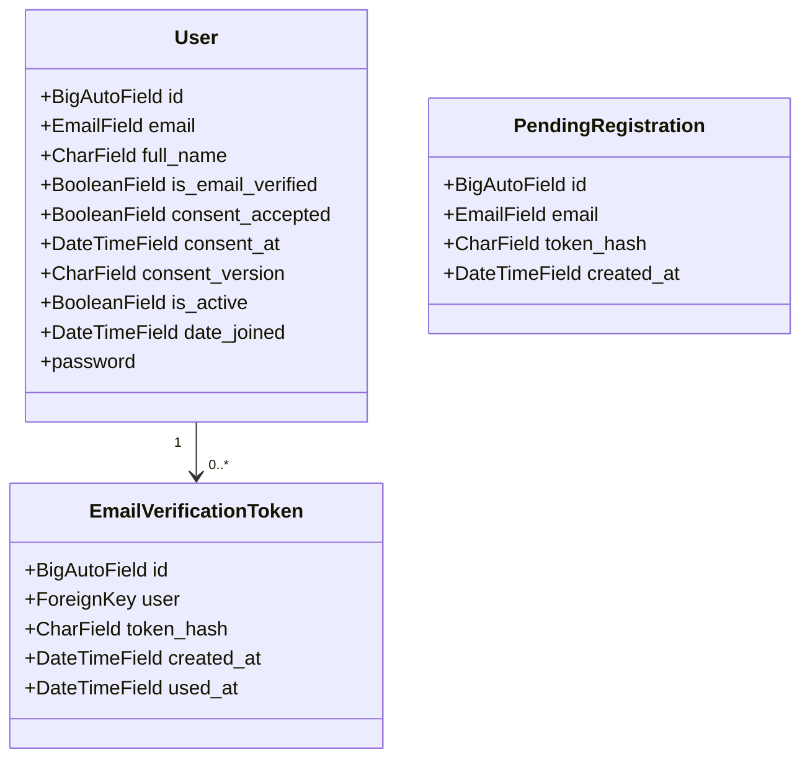

# Curator database schema (Sprint 1)

This document records the database foundation that is implemented in Sprint 1 and clearly separates it from entities planned for later sprints. Planned models are documented for design visibility only; they are not created as database tables in this branch.

## Sprint 1 status

The Django app currently implements only the account foundation required for institutional registration, email verification, and secure authentication.

## Implemented entities

### 1. User (`accounts_user`)

The project uses Django's custom authentication model:

- Model: `apps.accounts.models.User`
- User model setting: `AUTH_USER_MODEL = "accounts.User"`
- Primary key: `id` (Django BigAutoField)
- Login identifier: `email` (unique, normalized to lowercase)
- Password: stored through Django's `set_password()` / password hashing pipeline
- Required fields: `email`, `full_name`, `password`
- Verification fields: `is_email_verified`, `consent_accepted`, `consent_at`, `consent_version`
- Status fields: `is_active`, `is_staff`, `is_superuser`, `date_joined`
- Relationships: many-to-many with Django auth `Group` and `Permission`

Important constraints:

- `email` is unique in the database layer.
- A case-insensitive uniqueness constraint is enforced using `Lower(email)`.
- `full_name` is required. `UserManager._create_user()` strips surrounding whitespace, and `RegistrationForm` uses `strip=True`; `User.save()` normalizes email only and does not strip `full_name` on direct model saves.
- `username`, `first_name`, and `last_name` are intentionally removed from the custom user model to align with email-first authentication.

| Field | Type | Null | Notes |
| --- | --- | --- | --- |
| `id` | BigAutoField | No | Primary key |
| `password` | CharField | No | Django hashed password |
| `email` | EmailField | No | Normalized, unique |
| `full_name` | CharField | No | Required user display name |
| `is_email_verified` | BooleanField | No | Default `False` |
| `consent_accepted` | BooleanField | No | Default `False` |
| `consent_at` | DateTimeField | Yes | Time consent was recorded |
| `consent_version` | CharField | No | Version string for the consent notice |
| `is_active` | BooleanField | No | Default `True` |
| `is_staff` | BooleanField | No | Django admin access |
| `is_superuser` | BooleanField | No | Django superuser |
| `date_joined` | DateTimeField | No | Auto-populated |
| `last_login` | DateTimeField | Yes | Django auth support |

### 2. Pending registration (`accounts_pendingregistration`)

This table tracks an email that is awaiting a registration completion step:

- Model: `apps.accounts.models.PendingRegistration`
- Primary key: `id`
- `email`: normalized institutional email awaiting completion
- `token_hash`: unique digest of the pending-registration token
- `created_at`: timestamp of creation

Constraints and lifecycle:

- One active pending record per normalized email address is enforced by a case-insensitive unique constraint.
- Tokens are stored as hashes, not raw values.
- `complete_registration()` deletes the pending row after successful account creation. Invalid or expired links return an error without deleting the row; an expired row is cleaned up when a later registration request for the same email finds it.
- The model is intentionally limited to the registration flow and does not create a user row until verification succeeds.

### 3. Email verification token (`accounts_emailverificationtoken`)

This table stores single-use verification records for a user account:

- Model: `apps.accounts.models.EmailVerificationToken`
- Primary key: `id`
- `user`: FK to `User`, cascade delete
- `token_hash`: unique digest of the raw verification token
- `created_at`: token creation time
- `used_at`: marks a token as consumed after successful verification

Lifecycle:

- A token is considered valid only when it matches the current user, has not been used, and has not expired.
- A fresh verification request invalidates any prior unused token for the same user.
- Successful use sets `used_at` and marks the user as email verified.

## Relationship summary

`PendingRegistration` has no `ForeignKey` to `User`. It represents a pre-account registration state keyed by the normalized email address, and it is created before a `User` row exists. The model is used to reserve and verify a registration email request, while `EmailVerificationToken` is the only model in this Sprint 1 account schema that directly references a user via a database foreign key.

## Planned future-sprint entities (not implemented)

The following domain tables are intentionally documented only as planned work for future sprints and are not present in the current database schema:

- `Server`
- `Membership`
- `Channel`
- `Thread`
- `Reply`
- `Announcement`
- `Calendar`
- `Notification`
- `AuditLog`
- `ModerationReport`

These entities should be implemented only when the relevant sprint requirements and approval are in place. They are not part of Sprint 1.

## Migration note

The current Sprint 1 migration history includes the custom user migration, the user-attribute normalization migration, the verification-token migration, the case-insensitive email uniqueness migration, and the pending-registration migration. These migrations reflect the model state above and should remain stable unless a specific data-preservation issue requires a careful, reversible migration.
