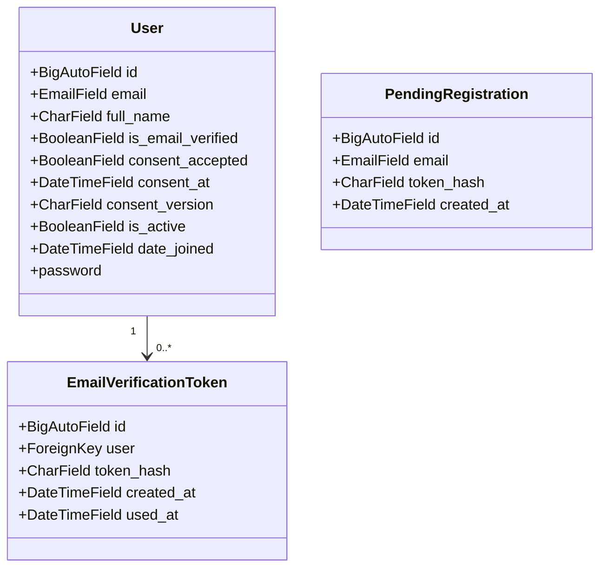

# Curator database schema (Sprint 1–2)

This document records the implemented account and server-foundation schema and clearly separates it from entities planned for later sprints. Planned models are documented for design visibility only; they are not created as database tables in this branch.

## Implementation status

Sprint 1 implements the account foundation required for institutional registration, email verification, and secure authentication. Sprint 2 Issue #19 implements the server, request, membership, subject-selection, and channel foundation. Request processing and other server workflows remain separate work.

## Implemented entities

### 1. User (`accounts_user`)

The project uses Django's custom authentication model:

- Model: `apps.accounts.models.User`
- User model setting: `AUTH_USER_MODEL = "accounts.User"`
- Primary key: `id` (Django BigAutoField)
- Login identifier: `email` (unique, normalized to lowercase)
- Password: stored through Django's `set_password()` / password hashing pipeline
- Required fields: `email`, `full_name`, `password`
- Verification fields: `is_email_verified`, `consent_accepted`, `consent_at`, `consent_version`
- Status fields: `is_active`, `is_staff`, `is_superuser`, `date_joined`
- Relationships: many-to-many with Django auth `Group` and `Permission`

Important constraints:

- `email` is unique in the database layer.
- A case-insensitive uniqueness constraint is enforced using `Lower(email)`.
- `full_name` is required. `UserManager._create_user()` and `RegistrationForm` strip surrounding whitespace and reject blank values. The database check constraint rejects empty or whitespace-only values, including direct model saves; `User.save()` normalizes the email address but does not strip `full_name`. Legacy accounts without a usable first or last name are backfilled as `Unknown User`.
- `username`, `first_name`, and `last_name` are intentionally removed from the custom user model to align with email-first authentication.

| Field | Type | Null | Notes |
| --- | --- | --- | --- |
| `id` | BigAutoField | No | Primary key |
| `password` | CharField | No | Django hashed password |
| `email` | EmailField | No | Normalized, unique |
| `full_name` | CharField | No | Required user display name |
| `is_email_verified` | BooleanField | No | Default `False` |
| `consent_accepted` | BooleanField | No | Default `False` |
| `consent_at` | DateTimeField | Yes | Time consent was recorded |
| `consent_version` | CharField | No | Version string for the consent notice |
| `is_active` | BooleanField | No | Default `True` |
| `is_staff` | BooleanField | No | Django admin access |
| `is_superuser` | BooleanField | No | Django superuser |
| `date_joined` | DateTimeField | No | Auto-populated |
| `last_login` | DateTimeField | Yes | Django auth support |

### 2. Pending registration (`accounts_pendingregistration`)

This table tracks an email that is awaiting a registration completion step:

- Model: `apps.accounts.models.PendingRegistration`
- Primary key: `id`
- `email`: normalized institutional email awaiting completion
- `token_hash`: unique digest of the pending-registration token
- `created_at`: timestamp of creation

Constraints and lifecycle:

- One active pending record per normalized email address is enforced by a case-insensitive unique constraint.
- Tokens are stored as hashes, not raw values.
- `complete_registration()` deletes the pending row after successful account creation. Invalid or expired links return an error without deleting the row; an expired row is cleaned up when a later registration request for the same email finds it.
- The model is intentionally limited to the registration flow and does not create a user row until verification succeeds.

### 3. Email verification token (`accounts_emailverificationtoken`)

This table stores single-use verification records for a user account:

- Model: `apps.accounts.models.EmailVerificationToken`
- Primary key: `id`
- `user`: FK to `User`, cascade delete
- `token_hash`: unique digest of the raw verification token
- `created_at`: token creation time
- `used_at`: marks a token as consumed after successful verification

Lifecycle:

- A token is considered valid only when it matches the current user, has not been used, and has not expired.
- A fresh verification request invalidates any prior unused token for the same user.
- Successful use sets `used_at` and marks the user as email verified.

## Implemented Sprint 2 entities

All user relationships below reference `settings.AUTH_USER_MODEL`. The models use Django `BigAutoField` primary keys.

### 4. Server (`servers_server`)

| Field | Type | Null | Notes |
| --- | --- | --- | --- |
| `name` | CharField(255) | No | Class or program name; not unique |
| `section` | CharField(64) | No | Defaults to `""`; not unique |
| `slug` | SlugField(100) | No | Unique server identity |
| `description` | TextField | No | Blank allowed; defaults to `""` |
| `is_active` | BooleanField | No | Defaults to `True` |
| `created_at` | DateTimeField | No | Set on creation |
| `created_by` | FK to User | Yes | `SET_NULL`; related name `servers_created` |

### 5. Server request (`servers_serverrequest`)

| Field | Type | Null | Notes |
| --- | --- | --- | --- |
| `requester` | FK to User | No | `CASCADE`; related name `server_requests` |
| `proposed_name` | CharField(255) | No | Requested class or program name |
| `proposed_section` | CharField(64) | No | Defaults to `""` |
| `status` | CharField(20) | No | Pending, approved, or rejected; defaults to pending |
| `cor_file` | CharField(255) | Yes | Private-storage key only |
| `cor_cleanup_status` | CharField(16) | No | `not_required`, `pending`, `processing`, or `complete`; defaults to `not_required` |
| `cor_cleanup_attempts` | PositiveIntegerField | No | Number of durably reserved cleanup attempts; defaults to `0` |
| `cor_cleanup_last_attempt_at` | DateTimeField | Yes | Time the latest cleanup attempt was durably reserved |
| `decision_reason` | TextField | No | Blank allowed; defaults to `""` |
| `reviewed_by` | FK to User | Yes | `SET_NULL`; related name `server_requests_reviewed` |
| `reviewed_at` | DateTimeField | Yes | Blank allowed |
| `created_server` | OneToOne to Server | Yes | `SET_NULL`; reverse name `creation_request` |
| `created_at` | DateTimeField | No | Set on creation |
| `updated_at` | DateTimeField | No | Updated on save |

### 6. Membership (`servers_membership`)

| Field | Type | Null | Notes |
| --- | --- | --- | --- |
| `user` | FK to User | No | `CASCADE`; related name `memberships` |
| `server` | FK to Server | No | `CASCADE`; related name `memberships` |
| `role` | CharField(20) | No | Student, officer, or president; defaults to student |
| `status` | CharField(20) | No | Active, left, or removed; defaults to active |
| `joined_at` | DateTimeField | No | Defaults to `timezone.now` |
| `last_activated_at` | DateTimeField | No | Defaults to `timezone.now` |
| `left_at` | DateTimeField | Yes | Blank allowed |
| `created_at` | DateTimeField | No | Set on creation |
| `updated_at` | DateTimeField | No | Updated on save |

### 7. Membership subject (`servers_membershipsubject`)

| Field | Type | Null | Notes |
| --- | --- | --- | --- |
| `membership` | FK to Membership | No | `CASCADE`; related name `subjects` |
| `subject_code` | CharField(64) | No | Unique within the membership |
| `subject_name` | CharField(255) | No | Blank allowed; defaults to `""` |
| `created_at` | DateTimeField | No | Set on creation |

### 8. Join request (`servers_joinrequest`)

| Field | Type | Null | Notes |
| --- | --- | --- | --- |
| `user` | FK to User | No | `CASCADE`; related name `join_requests` |
| `server` | FK to Server | No | `CASCADE`; related name `join_requests` |
| `student_number` | CharField(64) | No | Collected for the join request |
| `status` | CharField(20) | No | Pending, approved, or rejected; defaults to pending |
| `cor_file` | CharField(255) | Yes | Private-storage key only |
| `cor_cleanup_status` | CharField(16) | No | `not_required`, `pending`, `processing`, or `complete`; defaults to `not_required` |
| `cor_cleanup_attempts` | PositiveIntegerField | No | Number of durably reserved cleanup attempts; defaults to `0` |
| `cor_cleanup_last_attempt_at` | DateTimeField | Yes | Time the latest cleanup attempt was durably reserved |
| `decision_reason` | TextField | No | Blank allowed; defaults to `""` |
| `reviewed_by` | FK to User | Yes | `SET_NULL`; related name `join_requests_reviewed` |
| `reviewed_at` | DateTimeField | Yes | Blank allowed |
| `created_at` | DateTimeField | No | Set on creation |
| `updated_at` | DateTimeField | No | Updated on save |

### 9. Join-request subject (`servers_joinrequestsubject`)

| Field | Type | Null | Notes |
| --- | --- | --- | --- |
| `join_request` | FK to JoinRequest | No | `CASCADE`; related name `subjects` |
| `subject_code` | CharField(64) | No | Unique within the join request |
| `subject_name` | CharField(255) | No | Blank allowed; defaults to `""` |
| `created_at` | DateTimeField | No | Set on creation |

### 10. Channel (`channels_channel`)

| Field | Type | Null | Notes |
| --- | --- | --- | --- |
| `server` | FK to Server | No | `CASCADE`; related name `channels` |
| `name` | CharField(100) | No | Display name |
| `slug` | SlugField(100) | No | Unique within the server |
| `channel_type` | CharField(20) | No | Announcements, calendar, rules, or subject |
| `created_at` | DateTimeField | No | Set on creation |

### Constraints

- `servers_serverrequest_status_valid`: ServerRequest status is pending, approved, or rejected.
- `servers_membership_unique_user_server`: one Membership row per user and server, regardless of status.
- `servers_membership_one_active_president`: at most one active President per server; this does not guarantee every server has a President.
- `servers_membership_role_valid` and `servers_membership_status_valid`: Membership role and status are valid choices.
- `servers_membershipsubject_unique_code`: subject code is unique within a Membership.
- `servers_joinrequest_one_pending_per_user_server`: at most one pending JoinRequest per user and server.
- `servers_joinrequest_status_valid`: JoinRequest status is pending, approved, or rejected.
- `servers_joinrequestsubject_unique_code`: subject code is unique within a JoinRequest.
- `channels_channel_unique_server_slug`: channel slug is unique within a Server.
- `channels_channel_type_valid`: channel type is a valid choice.
- `channels_channel_unique_default_type`: each Server has at most one channel of each default type (announcements, calendar, and rules); subject channels may repeat.

### Differences from FSD §9.3 and scope boundary

- `ServerRequest` and `JoinRequest` replace the single `CoRRequest` entity.
- `MembershipSubject` and `JoinRequestSubject` replace `confirmed_subjects` and `ChannelAccess`.
- `Membership.status` is added.
- `Server.school_domain` and `Server.president_id` are omitted.
- `Server.section` and `ServerRequest.proposed_section` are added.
- The FSD's subject-channel metadata (`subject_code`, professor name/contact, and office hours) is deferred to Sprint 3 channel work; the Issue #19 `Channel` model is only the agreed foundation.

## Account relationship summary



`PendingRegistration` has no `ForeignKey` to `User`. It represents a pre-account registration state keyed by the normalized email address, and it is created before a `User` row exists. The model is used to reserve and verify a registration email request, while `EmailVerificationToken` is the only model in this Sprint 1 account schema that directly references a user via a database foreign key.

## Sprint 2 relationship summary

- A User may have many ServerRequests, JoinRequests, and Memberships. A membership is unique per user-server pair.
- A Server may have many Memberships, JoinRequests, and Channels. Each subject row belongs to one Membership or JoinRequest and cascades with its parent.
- A ServerRequest may optionally reference the Server created from it; deleting that Server clears the reference.
- JoinRequests and ServerRequests retain reviewer references only while the reviewer User exists; reviewer deletion sets those references to `NULL`.

## CoR cleanup lifecycle (Issue #23 / FR-009)

`ServerRequest` and `JoinRequest` track cleanup using the same three fields:

- `not_required` is the default for requests that have not reached a final
  decision.
- `processing` is a durably claimed attempt. A successful claim increments
  `cor_cleanup_attempts` and refreshes `cor_cleanup_last_attempt_at` before
  storage I/O. Other workers cannot claim a fresh `processing` row.
- A `processing` claim is considered abandoned after 30 minutes. The next
  cleanup attempt may atomically replace that expired claim with a new claim
  and increment the attempt counter. This fixed lease assumes storage work
  finishes within 30 minutes; a worker still running after lease expiry may
  overlap the recovery attempt. Deletion remains idempotent and stale workers
  cannot update a newer claim because completion/failure compare-and-set
  includes the reserved attempt number.
- A decision workflow must store the final approved/rejected status and set
  cleanup to `pending` in the same short database transaction.
- Ordinary model saves on a decided request cannot replace or clear its CoR
  key. The cleanup service clears the key only through a conditional update
  after `delete_cor()` confirms deletion or absence.
- `QuerySet.update()`, bulk operations, raw SQL, and shell-level direct
  mutation bypass this application-level guard and are unsupported for
  changing a decided request's CoR key.
- After the decision transaction commits, the cleanup service durably reserves
  an attempt, then verifies deletion or absence and marks cleanup `complete`.
- If deletion cannot be verified and another worker has not completed cleanup,
  the request returns to `pending`, retains its key, and can be retried.
- If recording the storage failure itself fails, the row remains
  `processing`; it becomes eligible for retry only after its claim expires.
- A final request with no file key is finalized as `complete` without a storage
  call or attempt increment.

Attempt counts represent reservations committed before storage, not exact
physical storage invocations. A process may crash after reservation commits
but before it calls storage, so a reservation can exist without a corresponding
storage invocation. Reserving before I/O prevents an actual storage attempt
from silently disappearing from the accounting when a later database write
fails.

Migration `servers.0002_cor_cleanup_lifecycle` backfills legacy approved or
rejected requests with a non-empty key to `pending`, and those without a key
to `complete`. Existing pending requests remain `not_required`; the migration
does not access storage or change business statuses or file keys. Its reverse
data operation is a no-op, preserving the legacy status and key values before
the new fields are removed.

No approval/rejection handlers currently exist in this branch. When adding one,
save the decision and `cor_cleanup_status=CorCleanupStatus.PENDING` inside its
existing transaction, then register
`transaction.on_commit(lambda: attempt_cor_cleanup(request))` after preserving
the existing membership/server/subject operations. Inspect the result and give
authorized operators only a generic indication when cleanup remains pending.
Do not delete the file inside the decision transaction.

Retry pending final decisions with:

```powershell
python manage.py cleanup_pending_cor_files
python manage.py cleanup_pending_cor_files --limit 100
python manage.py cleanup_pending_cor_files --dry-run
```

`--limit` is global across both request types, and selection alternates fairly
between them using the most recently attempted model as the round-robin cursor.
Expired `processing` claims are eligible for recovery by the command; fresh
claims are excluded. Dry-run reports aggregate eligible counts only; it does not check whether any
individual file exists. The command processes every selected request even if
one fails, reports aggregate counts, and exits nonzero when a processed
failure requires attention. This project has no recurring scheduler for retries:
operators must run the command manually or configure an external scheduled
job, and should monitor nonzero exits.

## Planned future-sprint entities (not implemented)

The following domain tables are intentionally documented only as planned work for future sprints and are not present in the current database schema:

- `Thread`
- `Reply`
- `Announcement`
- `CalendarEvent`
- `Notification`
- `AuditLog`
- `Report`

These entities should be implemented only when the relevant sprint requirements and approval are in place. They are not part of the current schema.

## Migration note

The Sprint 1 account migration history includes the custom user migration, the user-attribute normalization migration, the verification-token migration, the case-insensitive email uniqueness migration, the pending-registration migration, and the full-name backfill/check-constraint migration. The full-name migration replaces empty or whitespace-only legacy names with `Unknown User` before enforcing the database constraint. Sprint 2 adds initial migrations for `servers` and `channels`; the account migrations remain unchanged.
